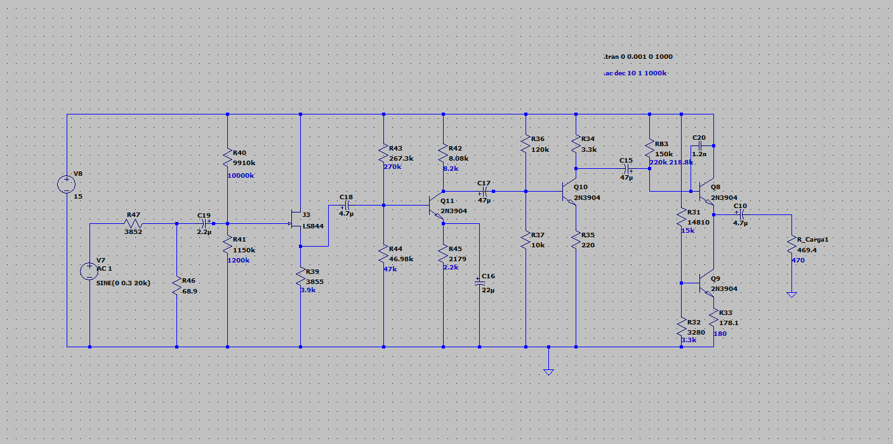
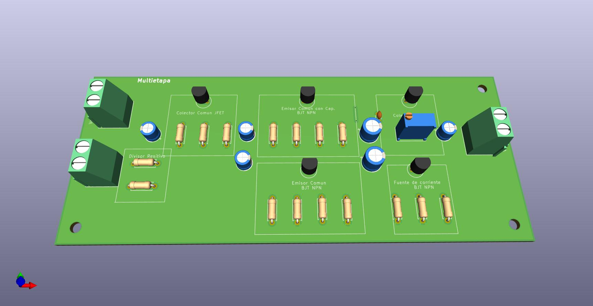
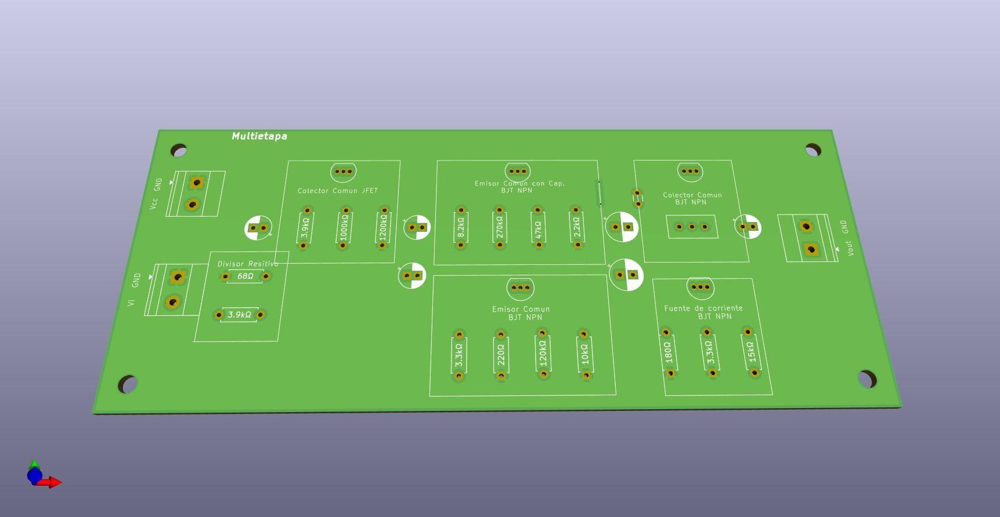
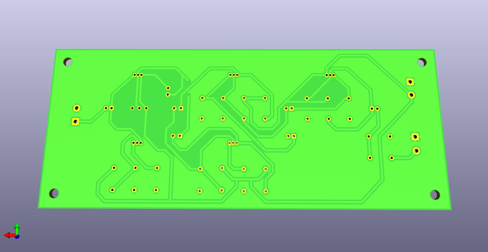

# Amplificador multietapa con componentes discretos

Laboratorio 8 de *Análisis y Diseño de Circuitos Analógicos I*: diseño e implementación de un amplificador clase A de varias etapas, usando solo componentes discretos (sin circuitos integrados).

El enunciado completo está en [`Laboratorio8.pdf`](Laboratorio8.pdf).

## Especificaciones

- Ganancia de tensión mayor a 300.
- Excursión de ±5 V sobre una resistencia de 470 Ω con acople capacitivo.
- Impedancia de entrada mayor a 300 kΩ.
- Impedancia de salida menor a 200 Ω.
- Debe trabajar en el rango de frecuencias de 100 Hz a 50 kHz.
- Consumo de potencia media total de 240 mW o menos.

Observaciones principales del enunciado: la fuente de tensión debe ser del menor valor posible y no superar los 20 V, y la impedancia de salida del generador es de 50 Ω. El resto de las observaciones están en el PDF.

## Circuito en LTspice

Esquemático del archivo `Clase_A.asc`. `V8` es la alimentación de 15 V y `V7` es el generador senoidal de entrada (0,3 V a 20 kHz). La señal entra por la izquierda, pasa por las cuatro etapas y sale hacia la carga `R_Carga1` de 470 Ω. Las etapas se acoplan entre sí con capacitores, de modo que cada una se polariza por separado.

## Etapas del amplificador

El amplificador se compone de cuatro etapas en cascada, más una fuente de corriente en la parte inferior del circuito.

| Etapa | Configuración | Para qué sirve |
|-------|---------------|----------------|
| 1 | JFET (`J3`, LS844) | Lograr una impedancia de entrada grande. |
| 2 | Emisor común con capacitor en el emisor (`Q11`) | Dar la mayor parte de la ganancia: el capacitor puentea la resistencia de emisor y permite amplificar una cantidad grande. |
| 3 | Emisor común sin capacitor en el emisor (`Q10`) | Amplificar un poco más la señal. |
| 4 | Colector común (`Q8`) | Lograr la impedancia de salida baja que pide la especificación. |
| — | Fuente de corriente (`Q9`) | Está conectada al emisor del colector común y fija su corriente de polarización. |

Los transistores bipolares son 2N3904. Los nombres de los componentes corresponden al esquemático de LTspice `Clase_A.asc`, que se alimenta con 15 V.

### Descripción de cada etapa

1. **Etapa de entrada con JFET (`J3`).** El generador se conecta a través de `C19` (2,2 µF) al terminal de compuerta, que se polariza con el divisor `R40` y `R41` (megaohms). El drenaje va a la alimentación y la salida se toma de la fuente, sobre `R39`. Funciona como seguidor: no amplifica la tensión, pero presenta una impedancia de entrada muy alta, para no cargar al generador, y entrega la señal a la etapa siguiente por `C18`.
2. **Primera etapa de ganancia (`Q11`).** Emisor común. La base se polariza con `R43` y `R44`, el colector tiene la resistencia de carga `R42` y el emisor tiene `R45` puenteada por el capacitor `C16` (22 µF). Para la señal el capacitor deja el emisor a masa, por lo que la ganancia es máxima: esta etapa aporta la mayor parte de la amplificación. La salida se toma del colector y pasa por `C17`.
3. **Segunda etapa de ganancia (`Q10`).** Emisor común sin capacitor en el emisor. La base se polariza con `R36` y `R37`, el colector con `R34` y el emisor con `R35` (220 Ω), que no está puenteada. Esa resistencia reduce la ganancia pero hace que sea más estable y lineal. Su salida pasa por `C15` hacia la etapa de salida.
4. **Etapa de salida (`Q8`).** Colector común (seguidor por emisor), polarizado desde la alimentación mediante `RB3`. No aumenta la tensión pero tiene impedancia de salida baja y puede entregar la corriente que pide la carga de 470 Ω, que se acopla por `C10` (4,7 µF).
5. **Fuente de corriente (`Q9`).** Está conectada al emisor de `Q8`. Su base se fija con el divisor `R31` y `R32` y su emisor tiene `R33`, de modo que mantiene una corriente casi constante. Esa corriente de polarización fija el punto de trabajo de `Q8` y le permite entregar el semiciclo negativo de la señal.

## Contenido del repositorio

- [`Multietapa/Kicad Multietapa/`](Multietapa/Kicad%20Multietapa/): proyecto de KiCad con el esquemático y el diseño del PCB (incluye backups automáticos en `.zip`).
- [`Multietapa/LTSpice Multietapa/`](Multietapa/LTSpice%20Multietapa/): simulaciones en LTspice (`Clase_A.asc`, `Draft1` y `Draft2`) con sus archivos de resultados `.log` y `.raw`.
- [`Laboratorio8.pdf`](Laboratorio8.pdf): enunciado y especificaciones.
- `Multietapa_pcb1.jpg`, `Multietapa_pcb2.jpg` y `Multietapa_pcb3.jpg`: imágenes del PCB.

## Imágenes del PCB

## Cómo abrir los archivos

- Los archivos `.asc` se abren con [LTspice](https://www.analog.com/en/resources/design-tools-and-calculators/ltspice-simulator.html).
- El proyecto de KiCad se abre desde [KiCad](https://www.kicad.org/) con el archivo `Multietapa.kicad_pro`.
