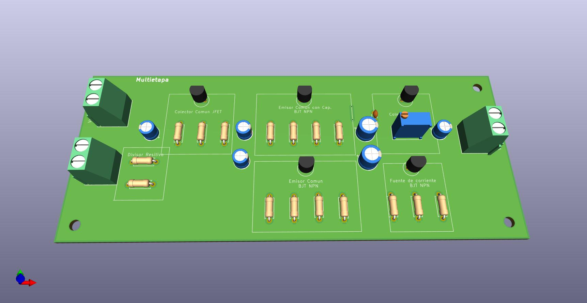
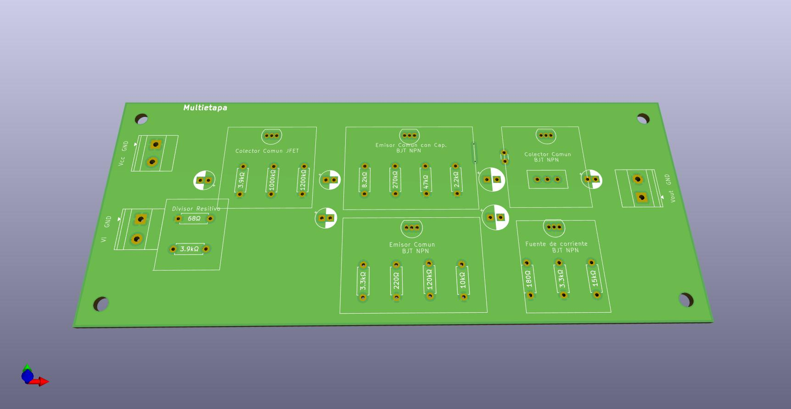
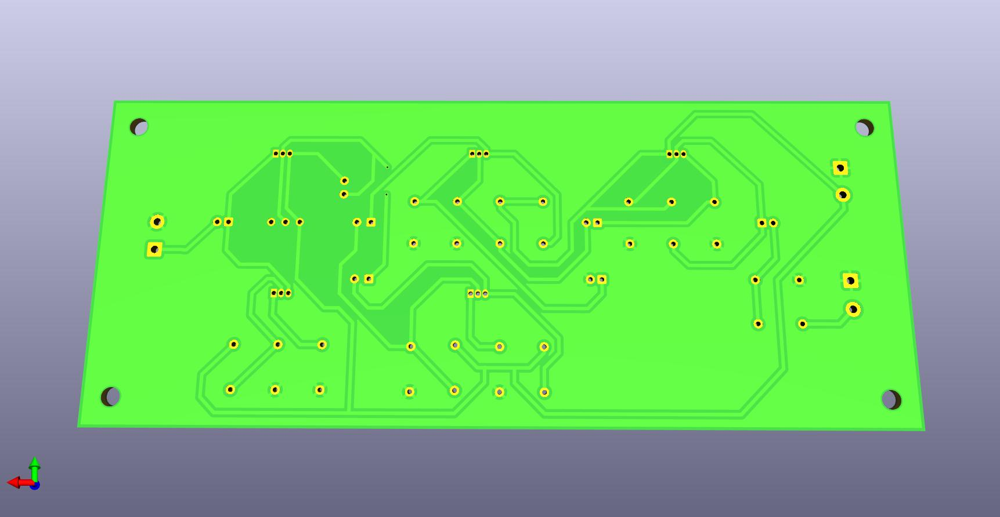

# Amplificador multietapa con componentes discretos

Laboratorio 8 de *Análisis y Diseño de Circuitos Analógicos I*: diseño e implementación de un amplificador clase A de varias etapas, usando solo componentes discretos (sin circuitos integrados).

El enunciado completo está en [`Laboratorio8.pdf`](Laboratorio8.pdf).

## Especificaciones

- Ganancia de tensión mayor a 300.
- Excursión de ±5 V sobre una resistencia de 470 Ω con acople capacitivo.
- Impedancia de entrada mayor a 300 kΩ.
- Impedancia de salida menor a 200 Ω.
- Debe trabajar en el rango de frecuencias de 100 Hz a 50 kHz.
- Consumo de potencia media total de 240 mW o menos.

Observaciones principales del enunciado: la fuente de tensión debe ser del menor valor posible y no superar los 20 V, y la impedancia de salida del generador es de 50 Ω. El resto de las observaciones están en el PDF.

## Etapas del amplificador

El amplificador se compone de cuatro etapas en cascada, más una fuente de corriente en la parte inferior del circuito.

| Etapa | Configuración | Para qué sirve |
|-------|---------------|----------------|
| 1 | JFET (`J3`, LS844) | Lograr una impedancia de entrada grande. |
| 2 | Emisor común con capacitor en el emisor (`Q11`) | Dar la mayor parte de la ganancia: el capacitor puentea la resistencia de emisor y permite amplificar una cantidad grande. |
| 3 | Emisor común sin capacitor en el emisor (`Q10`) | Amplificar un poco más la señal. |
| 4 | Colector común (`Q8`) | Lograr la impedancia de salida baja que pide la especificación. |
| — | Fuente de corriente (`Q9`) | Está conectada al emisor del colector común y fija su corriente de polarización. |

Los transistores bipolares son 2N3904. Los nombres de los componentes corresponden al esquemático de LTspice `Clase_A.asc`, que se alimenta con 15 V.

## Contenido del repositorio

- [`Multietapa/Kicad Multietapa/`](Multietapa/Kicad%20Multietapa/): proyecto de KiCad con el esquemático y el diseño del PCB (incluye backups automáticos en `.zip`).
- [`Multietapa/LTSpice Multietapa/`](Multietapa/LTSpice%20Multietapa/): simulaciones en LTspice (`Clase_A.asc`, `Draft1` y `Draft2`) con sus archivos de resultados `.log` y `.raw`.
- [`Laboratorio8.pdf`](Laboratorio8.pdf): enunciado y especificaciones.
- `Multietapa_pcb1.jpg`, `Multietapa_pcb2.jpg` y `Multietapa_pcb3.jpg`: imágenes del PCB.

## Imágenes del PCB

## Cómo abrir los archivos

- Los archivos `.asc` se abren con [LTspice](https://www.analog.com/en/resources/design-tools-and-calculators/ltspice-simulator.html).
- El proyecto de KiCad se abre desde [KiCad](https://www.kicad.org/) con el archivo `Multietapa.kicad_pro`.
